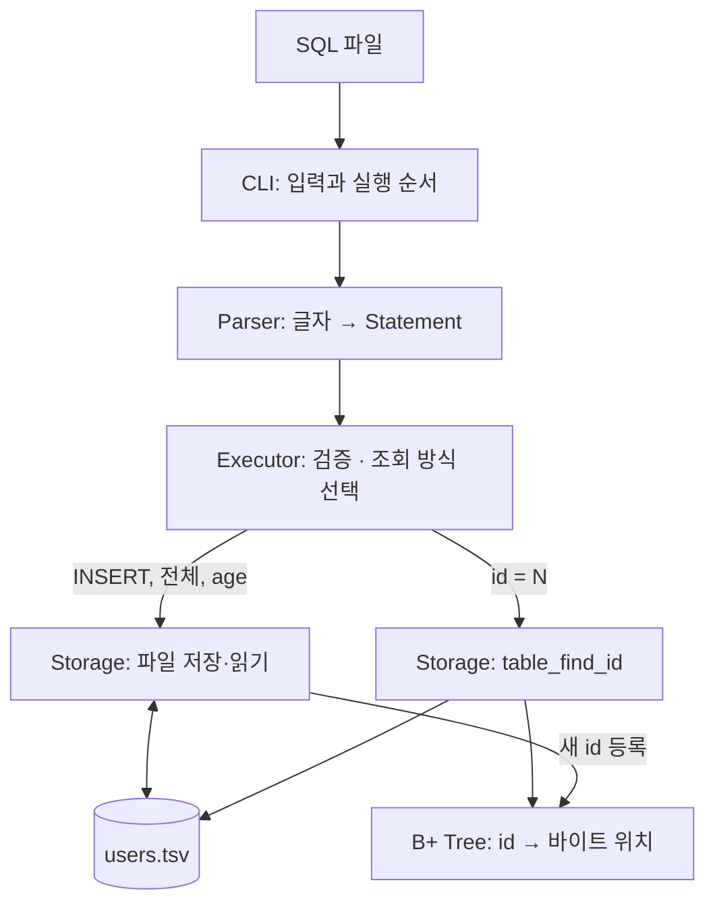

# Phase 2 구현설명서

현재 구현을 위에서 아래로 읽는 지도. 세부 함수는 해당 흐름이 궁금할 때만 내려가서 본다.
Phase 1 구현설명서([implementation.md](implementation.md))를 먼저 읽었다고 가정하고, **달라진 부분만** 설명한다.
성능 수치와 측정 환경은 [README](../README.md#100만-건-성능-비교)에 기록되어 있다.

## 1. 무엇이 달라졌나

Phase 1은 모든 조회가 파일 전체를 읽는 선형 탐색이었다. Phase 2는 `WHERE id = ?`만 메모리의 B+ 트리로 처리한다.



| 역할 | 코드 | 지금 확인할 것 |
|---|---|---|
| Executor | [executor.c](../src/executor.c) | WHERE 종류에 따라 인덱스 조회와 순차 탐색 중 선택 |
| Storage | [storage.c](../src/storage.c), [storage.h](../src/storage.h) | 인덱스 구축·갱신, `table_find_id` 추가 |
| **B+ Tree (신규)** | [bptree.c](../src/bptree.c), [bptree.h](../src/bptree.h) | `id → 레코드 시작 바이트 위치` 저장·검색 |
| **벤치마크 (신규)** | [benchmark.c](../tests/benchmark.c) | SQL INSERT 100만 건, id·age 조회 시간 비교 |

Parser, CLI, TSV 파일 형식은 Phase 1 그대로다. 사용자가 보는 SQL과 출력은 바뀌지 않는다.

## 2. 인덱스에 무엇을 넣나

```text
users.tsv                         B+ 트리 리프
────────────────────              ─────────────────────
1<TAB>kim<TAB>25<LF>   (0)   →    key=1, offset=0
2<TAB>lee<TAB>30<LF>   (9)   →    key=2, offset=9
3<TAB>park<TAB>41<LF>  (18)  →    key=3, offset=18
```

- 키는 id, 값은 **그 레코드가 시작하는 파일 바이트 위치**다. name·age는 트리에 없다.
- 트리는 메모리에만 있다. 파일에 저장하지 않으므로 프로그램을 켤 때마다 다시 만든다(3절).
- 위치(offset)는 `int64_t`다. 파일을 `"a+b"`(바이너리) 모드로 열어서 LF가 정확히 1바이트이므로 `줄 길이 + 1`로 다음 위치를 계산할 수 있다.

## 3. 시작할 때 — 인덱스 복원

```text
table_open
  → scan_rows(t, NULL, NULL, build_index=true)
      한 줄 읽기 → 형식 검증 → bptree_reserve_append → bptree_append(id, offset)
      offset += 줄 길이 + 1
  → 최대 id를 Table.last_id에 보관
```

Phase 1의 5절처럼 시작 준비와 SELECT가 같은 순차 읽기 함수 `scan_rows`를 공유하되, **`build_index` 플래그**가 켜졌을 때만 트리에 등록한다.

| 호출 | build_index | 하는 일 |
|---|---|---|
| `table_open` | true | 전체 검증 + 트리 구축 + 최대 id 복원 |
| `table_scan` (SELECT 전체, age) | false | 트리를 건드리지 않고 읽기만 |

시작 비용은 파일 크기에 비례한다. 100만 건에서 약 0.3초다(7절).

## 4. INSERT — 인덱스 자리 확보, 파일 쓰기, 키 등록

```text
Executor: validate_insert (Phase 1과 동일)
    ↓
Storage: table_append
  id = last_id + 1
  offset = 파일 끝 위치 (file_seek END → file_tell)
  ① reserve_index_entry     트리에 자리 확보 (메모리 할당·분할은 여기서 끝냄)
  ② fprintf + fflush         파일에 기록
  ③ bptree_append            확보한 리프에 (id, offset) 등록. 할당 없음
  ④ last_id = id
```

| 실패 지점 | 결과 |
|---|---|
| ① 메모리 부족 | 파일 쓰기 전에 실패한다. 일부 노드가 분할됐을 수 있지만 기존 키는 모두 조회할 수 있다. |
| ② 쓰기 실패 | 테이블에 `write_failed`를 표시하고 새 키 등록을 건너뛴다. 파일에 실제로 기록된 범위는 다시 열 때 검증한다. |

③은 이미 확보한 리프에 키와 위치를 기록한다. 쓰기에 실패한 테이블은 이후 INSERT·SELECT를 거부한다. 다시 열면 TSV를 검증하고, 완전한 행은 인덱스에 등록하며 잘린 행은 손상 오류로 보고한다.

## 5. B+ 트리 — 증가하는 키만 받는 구조

id는 항상 `최대 id + 1`이다. 따라서 **새 키는 언제나 가장 오른쪽 리프로 들어간다.** 이 구현은 이 사실에 맞춰 일반적인 삽입·삭제 대신 ‘오른쪽 끝 추가’만 지원한다.

### 노드 구조

```text
BPTreeNode (FANOUT = 64)
  leaf        리프 여부
  count       현재 키 개수
  keys[64]    정렬된 키
  entries     union
    offsets[64]   (리프)  각 키의 바이트 위치
    children[64]  (내부)  자식 노드 포인터
  next_leaf   (리프) 오른쪽 이웃 리프
```

| | 리프 | 내부 노드 |
|---|---|---|
| 최대 키 수 | 64 | 63 (자식 최대 64) |
| `entries`의 의미 | 키별 파일 위치 | 자식 포인터 |

리프의 `next_leaf`는 분할할 때 연결되지만 지금의 `bptree_find`는 쓰지 않는다. 범위 조회를 만들 때를 위한 구조다.

### 삽입: `bptree_reserve_append` → `bptree_append`

```text
reserve_append
  루트가 없음            → 빈 리프를 루트로 생성
  루트가 가득 참         → 새 루트를 만들고 기존 루트를 분할 (높이 +1)
  루트부터 오른쪽 끝으로 내려가며,
    내려가기 전에 가득 찬 자식을 먼저 분할
  → 한 자리 이상 비어 있는 가장 오른쪽 리프를 반환
append
  그 리프의 끝에 (key, offset) 기록, count++
```

내부 노드를 방문할 때는 최소 한 키를 추가할 공간이 확보되어 있다. 따라서 가득 찬 자식을 내려가기 전에 분할할 수 있다.

### 분할: `split_rightmost`

| | 리프 | 내부 노드 |
|---|---|---|
| 왼쪽에 남는 키 | `[0, middle)` | `[0, middle)` |
| 오른쪽으로 가는 키 | `[middle, count)` | `(middle, count)` |
| 경계 키 `keys[middle]` | **오른쪽 리프에도 남음** (부모에 복사) | **부모로 올라감** (오른쪽에 없음) |
| 추가 작업 | `next_leaf` 연결 | 자식 포인터 `count + 1`개 이동 |

리프가 가득 차서(64) 갈라지면 왼쪽 32개, 오른쪽 32개가 된다. 이후 새 키는 오른쪽 리프에만 쌓이므로 **왼쪽 노드는 반만 찬 채 남는다.** 일반 B+ 트리 삽입과 달리 순차 추가에 맞춘 선택이며, 메모리 사용량이 약 2배가 되는 대신 분할 로직이 단순하다.

### 검색: `bptree_find`

```text
node = root
내부 노드면:  upper_bound(key)  — key보다 큰 첫 키의 위치 — 의 자식으로 내려감
리프에서:     slot = upper_bound(key) - 1
              keys[slot] == key 이면 offsets[slot] 반환, 아니면 없음
```

- `upper_bound`는 이진 탐색이다. 내부 노드에서 경계 키와 **같으면 오른쪽**으로 간다. 리프 분할 때 경계 키가 오른쪽 리프에 남기 때문이다.
- 없는 id는 리프에서 `false`를 반환하고, 이 경우 데이터 파일은 읽지 않는다.

> 규모 감각 (구현 상수로 계산한 추정): 100만 건이면 리프 약 3만 개, 높이 약 4단계다. 노드 하나는 약 1KB라서 인덱스는 수십 MB 수준이다.

## 6. SELECT — 이제 경로가 셋

```sql
SELECT * FROM users WHERE id = 500000;
```

```text
Executor: executor_run, STMT_SELECT
  switch (st->where)
    WHERE_NONE → table_scan(t, on_row, ...)       전체 순차 읽기
    WHERE_AGE  → table_scan(t, filter_age, ...)   순차 읽기 + age 필터 콜백
    WHERE_ID   → table_find_id(t, id, on_row, ...)
                    ↓
Storage: table_find_id
  bptree_find        → offset 또는 "없음"
  없음               → 0 반환 (파일 접근 없음)
  file_seek(offset)  → read_row 한 줄 → parse_record
  row.id == id 인지 재확인
  fn(&row) 한 번 호출
```

Phase 1과 비교하면 이렇게 바뀌었다.

| | Phase 1 | Phase 2 |
|---|---|---|
| 조건 검사 | `row_matches`가 id·age·없음을 모두 처리 | **id는 Storage 앞단(인덱스)에서 해결**, age만 `filter_age`가 처리 |
| `WHERE id` 비용 | O(N) | 트리 탐색 + 한 줄 읽기 |
| 콜백 | `filter_row` | `filter_age` (id·전체는 필터 불필요) |

`table_find_id`는 인덱스가 가리키는 줄을 **읽은 뒤에도 다시 검증**한다. 줄이 손상됐거나 읽은 id가 요청한 id와 다르면 “파일 손상” 오류를 낸다. 단일 프로세스를 가정하므로 정상 상황에서는 일어나지 않지만, 열린 동안 파일이 외부에서 수정된 경우를 잡아내는 안전장치다.

`WHERE age`와 전체 조회는 여전히 선형 탐색이다. age에는 인덱스가 없다.

## 7. 100만 건 성능 비교

`tests/benchmark.c`가 `make bench`로 실행된다. 직접 새로 만든 함수를 부르지 않고 **Phase 1의 Parser와 Executor를 그대로** 거친다.

```text
빈 임시 디렉터리에서 table_open (기존 데이터가 있으면 중단)
  → INSERT 문을 parser_next → executor_run 으로 1,000,000번 실행
      (500,000번째만 name='target', age=150)
  → table_close → table_open        ← 인덱스 재구축 시간 측정
  → WHERE id = 500000  100,000회 반복
  → WHERE age = 150    10회 반복
  → 두 조회 모두 결과가 정확히 target 한 행인지 검증
```

| 항목 | 측정값 (README 기록) |
|---|---:|
| SQL INSERT 1,000,000건 | 7.748초 |
| 테이블 재열기 및 인덱스 재구축 | 0.313초 |
| `WHERE id = 500000` B+ 트리, 100,000회 평균 | 2.454 µs |
| `WHERE age = 150` 순차 탐색, 10회 평균 | 303.132 ms |

두 조회의 차이는 약 12만 배다 (303.132ms ÷ 2.454µs, 계산값).

측정 조건: Windows 10 Pro, i7-10875H, LLVM-MinGW Clang, `-O2`.

- **한 번 예열한 뒤 같은 열린 테이블에서 반복**한 평균이다. 쿼리 파싱·출력·재열기 시간은 제외했다.
- 수치는 “인덱스가 이미 메모리에 있을 때”의 값이다. SQL 파일을 CLI로 매번 새로 실행하면 시작할 때 재구축 비용(약 0.3초)이 포함된다.
- id 조회는 OS 파일 캐시에 있는 줄 하나를 읽는 시간이라, 첫 접근이 느린 디스크 환경에서는 달라질 수 있다.

## 8. 오류와 한계

| 상황 | 현재 동작 |
|---|---|
| 인덱스 메모리 부족 | 파일 쓰기 전에 INSERT 실패. 기존 키 유지 |
| 파일 쓰기 실패 | 테이블이 `write_failed`가 되어 이후 요청 거부. 트리에는 등록 안 됨 |
| 인덱스가 가리킨 줄이 손상·불일치 | `table_find_id`가 파일 손상 오류 반환 |
| 존재하지 않는 id 조회 | 오류 아님. 헤더만 출력, 파일 접근 없음 |
| 프로그램 재시작 | 트리는 사라지고 `table_open`이 TSV에서 다시 만듦 |

| 현재 선택 | 한계·아직 없는 기능 |
|---|---|
| 오른쪽 끝 추가만 지원 | 임의 키 삽입·삭제·갱신 불가 (DELETE/UPDATE가 생기면 재설계 필요) |
| 왼쪽 노드가 반만 참 | 메모리를 더 쓰지만 단순함 |
| 인덱스를 파일에 저장하지 않음 | 시작 시간이 데이터 양에 비례 |
| id 인덱스 하나 | age 조건은 여전히 O(N) |
| 단일 프로세스 | 외부에서 파일을 바꾸면 위치가 어긋남. 동시 접근 제어는 Phase 3 |

이 선택들을 실제 DB 전체의 보편적 동작으로 외우지는 않는다.

## 읽는 순서

1. README의 성능 표와 `make bench` 출력을 비교한다.
2. SELECT 경로(6절)에서 `WHERE id`가 어디로 갈라지는지 본다.
3. INSERT 경로(4절)에서 “자리 확보 → 파일 쓰기 → 등록” 순서를 본다.
4. 시작 시 복원(3절)이 같은 `scan_rows`를 재사용하는 것을 확인한다.
5. 트리 내부(5절)는 분할이 궁금할 때 `split_rightmost`와 `bptree_find`만 본다.
