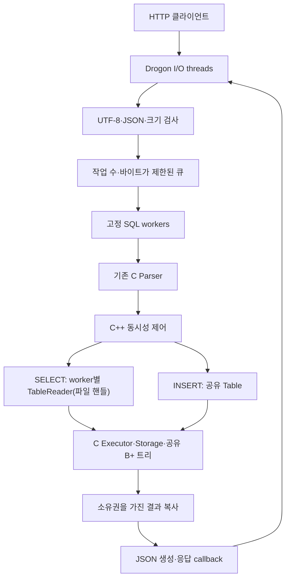

# Phase 3 구현 설명 — C 엔진을 유지한 C++ API 서버

## 1. 구현 범위와 빌드 경계

Phase 3는 기존 `src/common.c`, `parser.c`, `storage.c`, `executor.c`, `bptree.c`를 C17 static library인 `minidb_core`로 빌드한다. 기존 CLI의 `src/main.c`는 서버에 링크하지 않는다. C++17 서버는 별도 `server/` 디렉터리에서 빌드한다.

C 엔진에는 서버의 병렬 조회를 위해 읽기 함수만 추가했다([계획 06](plans/phase3-improvements/06-single-index.md)).
- `storage.h`: `TableReader`, `table_reader_open`, `table_reader_scan`, `table_reader_find_id`, `table_reader_close`
- `executor.h`: `executor_run_read`

또 줄 단위 읽기에서 `getc` 대신 FILE 잠금을 걸지 않는 `getc_unlocked`(Windows는 `_getc_nolock`)를 쓴다. 멀티스레드 서버에서 `getc`는 문자마다 잠금을 걸어 스캔이 약 5배 느렸다([B6](phase3-benchmarks/20261116/minimal-report.md#b6-스캔-읽기-루프의-file-잠금-제거--2026-11-17)). 같은 FILE을 두 스레드가 동시에 쓰지 않는다는 전제는 worker별 `TableReader`와 배타 gate로 지켜진다.

기존 공개 함수와 CLI의 동작은 바꾸지 않았다. 기존 `table_scan`과 `table_find_id`는 새 함수와 같은 내부 코드를 쓰는 wrapper가 됐다. 기존 C 검사·CLI 테스트·ASan/UBSan이 그대로 통과한다.

`server/c_api.hpp`가 기존 헤더를 `extern "C"`로 감싼다. 이는 C++ 호출자의 링크 이름을 C 함수 이름과 맞추는 역할이며, C 코드에 동기화를 추가하거나 C++ 코드로 다시 컴파일하는 기능은 아니다. 동기화는 C++ adapter가 맡는다.

| 파일 | 책임 |
|---|---|
| `server/main.cpp` | CLI 옵션, DB 디렉터리 잠금, HTTP API, JSON 계약, 종료 순서 |
| `server/engine.hpp`, `engine.cpp` | C ABI adapter, 요청별 파싱, 테이블 컨텍스트, DB 동시성 제어, 결과 소유권 |
| `server/c_api.hpp` | 원본 C 헤더의 링크 경계 |
| `server/writer_preferred_gate.hpp` | 내부 쓰기 우선 gate, 공유/배타 진입 조건 |
| `server/thread_pool.hpp`, `thread_pool.cpp` | 고정 worker, FIFO 대기열, 수락 제한, 종료·join, 계측 |
| `server/CMakeLists.txt` | C17/C++17 분리 빌드, CTest, sanitizer 옵션 |
| `server/cmake/DrogonDependency.cmake` | Drogon 커밋 고정 또는 설치된 패키지 연결 |
| `server/tests/` | 엔진·Thread Pool 단위 검증과 실제 HTTP 서버 통합 검증 |

원래 `Makefile`의 CLI·테스트·벤치마크 경로는 유지한다. 실행 명령과 HTTP 계약은 [서버 README](../server/README.md)에 정리했다.

## 2. HTTP와 SQL 실행을 분리한 구조

HTTP handler는 요청을 검사하고 작업을 제출한 뒤 반환한다. 기존 C 엔진의 blocking 파일 접근은 SQL worker가 실행한다. I/O thread에서 future를 기다리거나 파일을 탐색하지 않는다. 완료 callback은 Drogon이 해당 연결의 I/O loop에서 응답을 보내도록 넘긴다.

작업은 SQL 문자열과 응답 callback을 값으로 소유한다. HTTP handler의 지역 변수나 요청 내부 문자열을 참조로 저장하지 않는다. 엔진과 pool 등 서버 수명 객체는 작업이 모두 끝날 때까지 살아 있다.

## 3. C 엔진의 공유 상태 다루기

기존 `Table`에는 파일 스트림 하나, 자동 ID 상태와 B+ 트리가 들어 있다. SELECT도 파일 위치를 움직이므로, 하나의 `Table*`에 공유 lock만 붙여 여러 SELECT를 동시에 실행할 수는 없다. 반면 B+ 트리 조회(`bptree_find`)는 트리를 읽기만 하므로 인덱스 자체는 여러 스레드가 함께 읽어도 된다.

그래서 **인덱스는 하나를 공유하고, 파일 핸들만 worker마다 따로 둔다.** 서버 시작 시 `Table`을 하나 열고(파일 전체를 한 번 읽어 인덱스 구축), SQL worker마다 같은 파일을 읽기 전용으로 여는 `TableReader`를 하나씩 만든다. worker index는 Thread Pool의 수명 동안 고정된다.

| 컨텍스트 | 사용하는 작업 | 소유 |
|---|---|---|
| `Table` 1개 | INSERT | 쓰기용 `FILE*`, 최신 ID, **공유 B+ 트리** |
| `TableReader` W개 | SELECT | 각자 읽기용 `FILE*`. 인덱스는 `Table`의 것을 읽는다 |

불변 조건은 하나다. **공유 인덱스는 공유 gate 아래에서만 읽고, 배타 gate 아래에서만 바뀐다.** 인덱스가 하나뿐이므로 INSERT 직후 다른 worker의 ID 조회도 새 행을 바로 찾는다. 별도의 재조회 경로가 없다.

reader별 mutex는 같은 worker index를 잘못 중복 사용한 호출도 같은 `TableReader`에 동시에 들어가지 않게 하는 방어 장치다. HTTP 경로에서는 worker가 자기 index를 사용한다.

이전 구현은 worker마다 `Table`을 따로 열어 인덱스를 복제했다. 그 결과 다음 비용이 있었고, 모두 이 구조로 없앴다.
- 메모리·시작 시간이 worker 수에 비례
- 시작 시점 인덱스에 없는 새 ID를 쓰기용 `Table`에서 다시 찾는 재조회 장치(`first/last_insert_id`, writer mutex, 관련 지표)

측정 결과는 [최소 검증 결과](phase3-benchmarks/20261116/minimal-report.md)의 B4 절에 있다.

### 읽기·쓰기 gate

내부 헤더의 `WriterPreferredGate`는 다음 규칙을 적용한다. 별도 단위 테스트에서는 실제 writer 대기 등록 상태를 관찰해 순서를 검증하며, 운영 코드에 테스트용 정지 callback은 넣지 않는다.

- SELECT는 reader mutex → 공유 gate 순서로 획득한 뒤 `executor_run_read`를 호출한다. 서로 다른 reader는 동시에 실행할 수 있다.
- INSERT는 독점 gate만 획득한 뒤 `executor_run`을 호출한다. 실행 중인 SELECT가 끝난 뒤 시작하며, 쓰기 중에는 새 SELECT가 실행되지 않는다.
- 기다리는 writer가 있으면 새 reader가 먼저 통과하지 않도록 한다. 이미 진행 중인 reader를 중단하지는 않는다.
- reader와 writer는 서로 다른 condition variable에서 기다린다.
  - gate가 풀릴 때 대기 writer가 있으면 writer 하나만 깨우고, 없으면 reader를 모두 깨운다.
  - 이전에는 모든 대기 스레드를 깨웠다. 그 때문에 쓰기 비중이 높을 때 잠금 넘김 비용이 INSERT 실행 시간(약 15µs)의 수 배가 됐다.
  - 이 방식으로 바꾼 뒤 쓰기 99%·worker 8에서 처리량이 약 2.5배, 배타 gate 대기가 270→57µs로 개선됐다([B5](phase3-benchmarks/20261116/minimal-report.md#b5-gate-깨우기-방식-개선--2026-11-17)).

이 정책은 읽기와 쓰기를 동시에 진행하는 MVCC가 아니다. writer가 계속 들어올 때 reader의 기아가 없다는 보장이나, 요청 수락 순서와 완료 순서가 같다는 보장도 제공하지 않는다.

### 새 행이 보이는 이유

- **ID 조회:** INSERT는 배타 gate 안에서 공유 인덱스에 키를 추가하고, 문장의 모든 행을 한 번에 파일에 쓴 뒤 `fflush`한다. 키를 쓰기보다 먼저 넣지만 gate가 끝날 때까지 reader가 보지 않고, 쓰기에 실패하면 `write_failed`로 모든 조회가 거절되므로 파일에 없는 행을 가리키는 키를 읽지 않는다. 이후 SELECT는 공유 gate 아래에서 같은 인덱스로 위치를 찾고, 자기 `FILE*`를 그 위치로 `fseek`해 읽는다.
- **스캔:** 전체 조회와 age 조회는 매번 `fseek(0)`부터 읽는다. `fseek`는 stdio 버퍼와 EOF 상태를 비우므로, 이전에 파일 끝까지 읽었던 핸들도 새로 추가된 행을 읽는다.
- **추가가 끼어들지 않음:** 읽는 동안 INSERT가 막히므로 하나의 SELECT 실행 중 파일과 인덱스가 바뀌지 않는다. 이 성질은 모든 접근이 이 서버를 통한다는 조건에서 성립한다.
- **저장 실패:** 쓰기에 실패하면 공유 `Table`에 `write_failed`가 기록된다. 이후 모든 `TableReader` 조회도 같은 상태를 확인해 거절한다.

실제 읽기 오류는 정상적인 인덱스 miss로 취급하지 않는다.

## 4. 요청 하나의 실행 과정

### 실행 전 검사

HTTP 단계에서 UTF-8 JSON 객체인지, `sql` 문자열만 있는지, SQL 바이트 제한을 만족하는지 검사한다. 중복 JSON 키, 추가 JSON 값, 주석·trailing comma 등 허용하지 않은 JSON도 거절한다.

worker에서는 기존 `parser_next`로 첫 문장을 읽고, 다시 호출하여 뒤에 두 번째 문장이나 문법 오류가 없는지 확인한다. 이 확인이 끝나기 전에 INSERT를 실행하지 않는다. 따라서 `INSERT ...; SELECT ...;`와 잘못된 뒤쪽 문법을 포함한 요청은 첫 INSERT도 실행하지 않는다.

파싱된 `Statement`는 RAII 객체가 `statement_free`로 해제한다. SQL 입력에 NUL이 포함되면 C 문자열에서 뒤쪽 내용이 사라지는 문제를 피하도록 미리 거절한다.

### INSERT

서버는 기존 스키마 범위를 미리 확인하여 값 오류를 HTTP 422로 분류한다. 실제 `executor_run`도 원래의 검증을 계속 수행한다.

독점 gate를 획득한 뒤 기존 `executor_run`을 호출한다. 기존 Storage가 파일과 인덱스 작업을 마치고 성공 callback을 호출하면, adapter는 ID와 `committed` 상태만 기록한다. 이 callback은 메모리를 할당하지 않고 C++ 예외를 밖으로 던지지 않는다.

여러 행 INSERT(`VALUES (...), (...)`, 최대 1,000행)도 문장 하나이므로 gate를 한 번만 잡는다. callback은 행마다 한 번 불리며, adapter는 첫 ID·마지막 ID·개수만 갱신한다. gate가 문장 전체를 덮으므로 한 문장의 ID는 항상 연속이고, 다른 요청의 행과 섞이지 않는다. 응답은 `inserted_id`(첫 ID), `last_inserted_id`, `affected_rows`(행 수)다. 값 오류는 C executor가 모든 행을 검증한 뒤 기록하므로 한 행도 쓰지 않는다. 쓰는 도중 저장 실패로 일부 행만 기록되면 `STORAGE_ERROR`와 함께 `write_outcome: partial` 및 기록된 ID 범위를 돌려준다. 1,000행 상한은 gate 점유 시간(INSERT 한 건 약 13µs 기준 약 13ms, 추정)과 기본 SQL 크기 제한 64 KiB에 맞춘 값이다. 한 문장의 행은 한 번에 쓰고 한 번 flush한다([08 group commit](plans/phase3-improvements/08-group-commit.md)). C 벤치마크에서 1,000행 문장 1,000개(100만 행)는 약 3.3초에서 약 0.2초로 줄었다(3회 중앙값). gate 점유 시간도 같은 비율로 줄 것으로 보지만 서버에서 직접 측정하지는 않았다.

여기서 `committed`/`write_outcome: applied`는 기존 C API가 INSERT 성공을 알렸다는 뜻이다. 트랜잭션 commit, WAL 기록, `fsync`에 의한 전원 장애 내구성을 추가한 뜻은 아니다. 기존 엔진의 flush·오류 처리 계약을 유지한다.

### SELECT

기존 `ResultSink`가 넘기는 `Row`와 이름 문자열은 callback 동안만 유효하다. adapter는 반환 전에 `OwnedRow`로 복사한다. C 객체 내부 포인터를 JSON 처리 단계까지 보관하지 않는다.

수집 callback은 행 수와 보수적인 JSON 크기 예산을 확인한다. 결과 상한이나 할당 실패가 발생하면 C callback의 오류 값으로 전달하고, C++ 예외가 C 호출 경계를 지나가지 않게 한다. 상한 초과 시 부분 결과를 성공으로 내보내지 않는다.

엔진 lock을 해제한 다음 JSON을 생성하고 실제 직렬화 크기를 다시 확인한다. 네트워크 전송 시간 동안 DB gate를 잡고 있지 않는다. 기존 파일에 API가 요구하는 UTF-8로 표현할 수 없는 이름이 있으면 JSON 반환 단계에서 오류로 처리한다.

## 5. 큐, 만료, 종료

Thread Pool은 worker를 처음에 만들고 요청마다 새 thread를 만들지 않는다. mutex와 condition variable로 대기열을 보호하며 작업 실행과 작업 캡처의 해제는 queue mutex 밖에서 한다.

수락 시점에 대기 작업 수와 원본 JSON 본문 바이트 합을 확인한다. 이미 실행 중인 작업은 이 큐 예산에서 제외한다. `try_submit`은 빈자리가 생기기를 기다리지 않고 `Accepted`, `Full`, `Stopped` 중 하나를 반환한다.

작업 수락 실패는 HTTP 503으로 응답한다. worker가 작업을 시작할 때 대기 만료를 검사하며, 만료되면 C 엔진에 진입하지 않는다. 이 검사는 엔진 lock 대기와 실행 중인 파일 I/O를 중단하지 않는다.

정상 종료 순서는 다음과 같다.

1. 신호 handler는 종료 요청 flag만 설정한다.
2. event loop가 종료 요청을 감지하여 신규 작업을 거절한다.
3. main event loop에서 pool의 수락을 막고 기존 작업을 drain한 뒤 worker를 join한다. 별도 HTTP I/O loop들은 이 동안 응답 callback을 처리할 수 있다.
4. event loop를 종료하고 DB 컨텍스트를 해제한다.

수락한 작업은 실행 또는 만료 처리로 끝나지만, 클라이언트가 최종 응답을 수신한다는 보장은 없다. 이미 적용한 INSERT를 연결 종료 때문에 rollback하지 않는다. 무한정 걸리는 엔진 작업을 강제로 중단하거나 종료 시간을 상한으로 묶는 기능도 없다.

## 6. 프로세스와 오류 경계

같은 데이터 디렉터리를 여는 새 Phase 3 서버끼리는 OS 파일 잠금으로 충돌을 막는다. Unix에서는 `flock`, Windows 경로에서는 배타적 파일 열기를 사용한다. 원래 CLI는 이 잠금을 사용하지 않으므로 서버가 실행 중인 디렉터리에 CLI나 다른 프로그램이 접근하지 않아야 한다.

읽기 실패 등 일관성을 계속 신뢰할 수 없는 상태에서는 엔진을 사용 불가능으로 표시하고 이후 요청을 거절한다. INSERT 오류에서는 공개 C API로 writer의 `write_failed` 상태를 확인한다. 이 확인은 일반적인 파일 건강 검사나 실패한 쓰기의 적용 여부 판정이 아니다.

일부 저장 오류와 연결 실패는 INSERT 적용 여부를 확정할 수 없다. 오류 응답의 `unknown`과 성공 callback을 확인한 `applied`를 구별하며, 서버는 실패한 INSERT를 자동 재시도하지 않는다.

## 7. 계측의 의미

`GET /metrics`는 JSON을 반환한다. 시간 누적값의 단위는 마이크로초다.

| 계측 | 해석 |
|---|---|
| `pool.queued`, `queued_bytes` | 현재 대기열의 작업 수·회계 바이트 |
| `pool.active`, `peak_active` | 작업을 가져간 worker 수. 엔진 lock 대기도 포함 |
| `pool.accepted`, `completed`, `rejected` | 수락·처리 종료·수락 거절 작업 수 |
| `pool.failed_tasks` | 작업 callback에서 밖으로 나온 예외를 pool이 포착한 수. `completed`에도 포함 |
| `pool.queue_wait_us`, `max_queue_wait_us` | enqueue에서 worker가 가져갈 때까지의 누적·최대 대기 |
| `pool.expired` | worker의 실행 전 만료 검사에서 끝난 작업 수 |
| `engine.requests` | adapter의 `execute` 호출 수. 만료된 요청은 포함하지 않음 |
| `engine.successful_inserts`, `successful_selects`, `errors` | 엔진 adapter 처리 결과. 문장 단위로 센다(여러 행 INSERT도 1). 일부만 기록된 INSERT는 `errors`로 센다 |
| `engine.current_executions`, `peak_executions` | C executor 호출(`executor_run`, `executor_run_read`) 범위의 현재·최대 중첩 수 |
| `engine.lock_wait_us` | reader mutex와 gate의 누적 대기 |
| `engine.lock_wait.<종류>.count` | 해당 잠금의 성공한 획득 횟수. 경합 없이 획득한 경우도 포함 |
| `engine.lock_wait.<종류>.total_us`, `max_us` | 획득 직전→직후의 누적·최대 시간. 보유 시간 제외 |
| `engine.execution_us` | C executor 호출에 쓴 누적 시간 |

잠금 종류는 `reader_mutex`, `read_gate`, `write_gate`다. `count`를 실제 경합 횟수로 해석하지 않는다. 평균 획득 시간은 count가 양수일 때 `total_us / count`로 계산하며, microsecond 미만 시간은 0이 될 수 있다. 모든 작업이 끝나면 세 `total_us`의 합과 기존 `lock_wait_us`가 일치한다.

단일 인덱스로 바꾸면서(계획 06) 재조회가 없어졌으므로 `engine.fallbacks`, `engine.fallbacks_skipped`, `lock_wait.insert_writer_mutex`, `lock_wait.fallback_mutex`를 제거했다.

engine 카운터는 각각 atomic으로 읽으므로 실행 중인 snapshot에서 모든 수가 정확히 같은 순간의 상태를 나타내지는 않는다. 최대값은 가산 카운터가 아니므로 두 snapshot의 차이를 측정 구간의 최대 대기로 해석하지 않는다. `peak_executions > 1`은 executor 호출이 중첩됐음을 보여주지만, 단일 SQL을 병렬화했거나 처리량이 개선됐다는 증거는 아니다.

## 8. 성능의 범위와 비용

### 측정 결과 (현재 구조)

100만 행, Linux 컨테이너(CPU 8개·메모리 6GiB)에서 측정했다. 서버와 같은 컨테이너에서 부하 생성기를 4개 프로세스·연결 32개로 돌렸다. 각 조건은 워밍업 5초, 측정 30초, 반복 3회다. 수치는 개선 전 구조와 번갈아 측정한 [측정 보고서](phase3-benchmarks/20261116/minimal-report.md)의 B4~B6에서 가져왔다.

| 부하 | 지표 | worker 1 | worker 8 |
|---|---|---:|---:|
| 스캔 90% + INSERT 10% | 처리량 | 20.4–20.6 RPS | 97–101 RPS |
| | 스캔 1회의 C 실행 시간 | 약 49 ms | 약 66 ms |
| | INSERT p99 | 1.69–1.70 s | 0.35–0.40 s |
| INSERT 99% + ID 조회 1% | 처리량 | — | 3.25만–3.33만 RPS |
| | 읽기 p99 / 쓰기 p99 | — | 19.6–20.2 ms / 1.7–1.8 ms |
| 공통 | RSS | 41 MB | 41 MB |
| | 시작 시간 | 약 0.1 s | 약 0.1 s |

- **병렬 처리 효과:** 같은 W개의 reader를 두고 DB 실행만 직렬화한 비교 서버는 worker 수와 관계없이 스캔 부하 처리량이 약 3.7 RPS(구 측정)에 머물렀다. 병렬 서버는 worker 수에 따라 늘었다(B1).
- **worker 8이 8배가 아닌 이유:** 스캔 1회 실행 시간이 worker 1의 49ms보다 길다(66ms). CPU 8개를 서버와 부하 생성기가 나눠 쓰기 때문으로 보인다.
- **INSERT 위주 부하의 처리량:** 약 3.3만 RPS는 이 부하 생성기가 경합이 적을 때 내는 처리량과 비슷하다. 서버 한계로 해석하지 않는다.

### 한계

- **긴 스캔은 INSERT를 기다리게 한다.** 스캔은 공유 gate를 끝까지 잡는다. 스캔 위주 부하에서 INSERT p99가 0.35–1.7초인 이유다. 스캔이 시작 시점의 파일 끝까지만 gate 없이 읽게 하면 줄일 수 있지만, 아직 구현하지 않았다.
- **쓰기가 몰리면 읽기가 밀린다.** gate가 쓰기 우선이기 때문이다. INSERT 99%에서 읽기 p99는 쓰기 p99의 약 11배다. 도착 순서 gate는 읽기 p99를 줄였지만 처리량이 34% 줄어 채택하지 않았다(B3).
- **INSERT는 직렬이다.** ID가 `last_id + 1`이고 파일이 ID 순서여야 하기 때문이다. 현재 INSERT 한 건의 C 실행은 약 13µs라 병목이 아니다. `fsync`를 도입하면 여러 INSERT를 묶어 한 번에 기록하는 group commit이 다음 단계다.
- **비용은 핸들과 결과 처리에 있다.**
  - 파일은 worker 수 + 1개의 핸들로 열리고, 핸들마다 stdio 버퍼가 있다.
  - 결과 복사, JSON 직렬화와 HTTP 전송 비용은 인덱스 검색 시간과 별개다.
- **메모리 상한은 근사치다.** 결과·대기열 제한은 과도한 단일 요청과 대기열 증가를 제어한다. 하지만 프로세스 전체 메모리를 정확한 상한으로 제한하지는 않는다.

Phase 2의 100만 건 ID/age 조회 수치(README)는 C 엔진 단독 측정이며 HTTP 서버 성능으로 쓰지 않는다. 부하 생성기 사용법은 [벤치마크 실행 설명](../server/benchmarks/README.md)에 있다. 각 개선의 판단 과정은 [개선 계획](plans/phase3-improvements/README.md)에 있다.

## 9. 의존성 선택

기본 빌드는 Drogon v1.9.14 커밋 `3aae769cc405cf5abb9d477675c6430924f02c7c`와 해당 커밋이 지정한 Trantor `78e480f5e138acdc05f76c55a2716718cd846364`를 사용한다. CMake에서 ORM·외부 DB client·예제·code generator·외부 라이브러리 테스트를 제외한다. HTTP에 필요하지 않은 TLS도 기본값에서 제외한다.

JSON은 Drogon과 함께 사용하는 JsonCpp로 처리한다. DB는 이 라이브러리의 ORM이나 외부 DB로 교체하지 않는다. JsonCpp·uuid·zlib의 정확한 시스템 패키지 버전과 컴파일러는 실행 환경에 따라 달라지므로 전체 환경을 완전히 고정한 빌드라는 의미는 아니다.

- [Drogon v1.9.14 소스](https://github.com/drogonframework/drogon/tree/v1.9.14)
- [Drogon threading model](https://github.com/drogonframework/drogon/wiki/ENG-FAQ-1-Understanding-drogon-threading-model)
- [Drogon 설치 안내](https://github.com/drogonframework/drogon/wiki/ENG-02-Installation)

Phase 3의 기본 재현 경로는 Linux/WSL와 Docker다. 원래 Phase 1·2의 Windows 빌드를 보존하지만, 그것만으로 새 C++ 서버의 모든 Windows toolchain 조합까지 검증했다는 뜻은 아니다.

## 10. 초기 구현의 검증 기록 (이전 구조)

> 이 절은 첫 구현(`3b19667`) 당시의 기록이다. 그때는 worker마다 `Table`을 따로 열어 인덱스를 복제했다. 새 ID는 쓰기용 `Table`에서 다시 찾았고(`engine.fallbacks`), C 코드는 수정하지 않았다. 현재 구조와 다르다. 현재 검증 결과는 11절 끝의 "현재 기준 검증"을 본다.

2026-11-16에 Linux에서 GCC/G++ 14.2.0, CMake 3.31.10, Drogon v1.9.14, JsonCpp 1.9.6으로 확인했다. HTTP 서버는 Release 빌드로 검증했고, sanitizer는 별도 실행 파일을 사용했다.

| 검증 | 결과 |
|---|---|
| 기존 `make test` | C 단위 검증 30,407건, CLI 통합 테스트 28건 통과 |
| Phase 3 Release 빌드 | C17 엔진과 C++17 서버를 분리 컴파일하고 링크 성공 |
| `ctest --test-dir build/server --output-on-failure` | 엔진·Thread Pool·HTTP의 3개 suite 모두 통과. HTTP suite는 8개 테스트 포함 |
| Thread Pool 단독 검증 | 용량·바이트 제한, FIFO, 종료, 동시 producer, 예외 처리 등을 포함한 7개 테스트 통과 |
| ThreadSanitizer | 엔진·Thread Pool 테스트 통과, 데이터 race 보고 없음 |
| AddressSanitizer·UBSan | 엔진 테스트 통과. 이 실행은 `ASAN_OPTIONS=detect_leaks=0` 사용 |
| 100만 행 HTTP 통합 검증 | 병렬 전체 파일 탐색 8건, 동시 INSERT·즉시 ID 조회 64쌍 통과 |
| 기존 코드 보존 | Phase 2 기준 커밋 `20b9d5b55c9e8a78b4fa313a90a1ff343419d1fc`의 `src/`, `Makefile`, 기존 `tests/`와 차이 없음 |

100만 행 검증은 TSV fixture를 미리 생성하고 4개 SQL worker로 수행했다. 100만 번의 HTTP INSERT를 실행한 결과는 아니다. 새 ID는 1,000,001~1,000,064였고 각 INSERT 직후의 조회에서 해당 행을 확인했다. 마지막 계측값은 다음과 같다.

| 계측 | 값 |
|---|---:|
| `pool.accepted`, `pool.completed` | 각각 136 |
| `engine.successful_selects` | 72 |
| `engine.successful_inserts` | 64 |
| `engine.errors` | 0 |
| `pool.rejected`, `pool.expired`, `pool.failed_tasks` | 각각 0 |
| `engine.peak_executions` | 4 |
| `engine.fallbacks` | 64 |

이 결과는 큰 파일에서의 기능·일관성과 독립 executor 호출의 중첩을 확인한다. worker 수별 처리량이나 지연 시간 비교를 수행한 성능 benchmark는 아니다. 같은 검증을 재현하는 명령은 [서버 README](../server/README.md#검증-명령)에 있다.

HTTP 통합 테스트에는 잘못된 입력의 INSERT 부작용 방지, 결과·큐 상한, 큐 대기 만료, 두 서버의 동일 디렉터리 접근 차단, 정상 종료 중 수락한 INSERT 처리, 재시작, 64비트 ID와 잘못된 저장 UTF-8 처리가 포함된다. 저장 쓰기 오류 후의 사용 불가 상태는 엔진 테스트에서 실제 파일 크기 제한으로 검증했다.

LeakSanitizer는 실행 환경의 ptrace 제약 때문에 실행할 수 없어 메모리 누수 검증 결과에는 포함하지 않는다. HTTP 프레임워크 전체에 sanitizer를 적용한 검증, Docker 이미지 실행, Windows 네이티브 서버 빌드는 이번 검증 범위에 포함하지 않았다.

## 11. 후속 개선 검증 — 2026-11-16~17

> 아래는 개선을 진행한 순서대로 남긴 기록이다. 중간 수치(예: RSS 313MB, 읽기 p99 120ms대)는 그 시점 구조의 값이며, 이후 개선으로 바뀌었다. 현재 수치는 8절에 있다.

`2cccc9b` 이후 미커밋 변경에 대해 Debian bookworm/GCC 12.2/CMake 3.25.1 컨테이너에서 fallback 상한, 확정적 동시성 테스트, 잠금별 지표를 검증했다. Release CTest 6개 suite(일반 API 9개, 제어 API 2개 포함)가 통과했다. 기존 `make test`의 C 검사 30,407건과 CLI 28개도 통과했다. 직렬 비교 서버의 INSERT·재시작, 미래 ID 가시성, 잠금 지표 API 검사 3개도 통과했다.

기본 컨테이너(WSL2 커널)의 TSan은 빌드 뒤 `unexpected memory mapping`으로 테스트 본문 전에 종료된다. 그래서 컨테이너를 `--security-opt seccomp=unconfined`로 띄우고 각 테스트를 `setarch "$(uname -m)" -R`로 실행해 해당 프로세스의 ASLR만 껐다. 이 조건에서 `minidb_gate_test`, `minidb_engine_test`, `minidb_engine_gate_test`, `minidb_pool_test`가 모두 통과했고 TSan 경고는 0건이었다. 자세한 내용은 [최소 검증 결과](phase3-benchmarks/20261116/minimal-report.md)에 있다. 이번 후속 작업에서는 ASan/UBSan을 새로 실행하지 않았다. 테스트 변경의 검출력은 gate 우선순위 제거, 엔진 공유 잠금 조기 해제, 종료 시 drain 생략의 세 의도적 변형이 각각 실패하는 것으로 확인했다.

성능 비교는 [축소 계획](plans/phase3-improvements/05-minimal-verification.md)에 따라 27개 조건만 측정했다.

- **스캔·쓰기 혼합:** 병렬 서버의 처리량이 worker 1·2·4·8에서 3.7·6.7·11.7·18.1 RPS였다. worker 8에서는 직렬 서버의 4.9배다.
- **비용:** RSS가 75MB에서 313MB로, 시작 시간이 0.21초에서 0.95초로 worker 수에 비례해 늘었다.
- **공정성:** worker 8에 쓰기 99% 포화 부하를 걸면 읽기 p99가 120–131ms로 쓰기 p99(약 3.3ms)의 약 38배였다. 읽기가 멈추지는 않았다(최장 무진행 구간 0.11초).
  - 그래서 도착 순서(티켓) gate 후보를 벤치마크 전용 빌드로 비교했다.
  - 후보는 읽기 p99를 4.4ms로 줄였지만 처리량이 34% 줄고 쓰기 p99가 30% 늘었다.
  - 채택하지 않고 현재 쓰기 우선 정책을 유지한다.
- **깨우기 개선(2026-11-17):** 쓰기 우선 정책은 그대로 두고, gate가 대기 writer 하나만 깨우도록 바꿨다. 같은 쓰기 99% 부하에서 처리량이 약 1.3만→3.3만 RPS, 읽기 p99가 약 130→20ms, 쓰기 p99가 3.3→1.7ms가 됐다. 스캔 부하는 변화가 없었다.
- **스캔 잠금 제거(2026-11-17):** `getc_unlocked`로 바꾼 뒤 스캔 혼합 처리량이 worker 1에서 3.9→20.5 RPS, worker 8에서 19.6→약 100 RPS가 됐다. 스캔 중 INSERT p99는 worker 8에서 1.8→0.4초로 줄었다.
- **비용 수치 갱신:** 위 RSS·시작 시간 증가는 인덱스 복제 구조의 측정값이다. 단일 인덱스 전환 뒤에는 worker 수와 무관하게 약 41MB, 0.1초다(B4).

결과는 [최소 검증 결과](phase3-benchmarks/20261116/minimal-report.md)에 있다.

### 현재 기준 검증 (`d6e573d`, 2026-11-17)

| 검증 | 결과 |
|---|---|
| `make test` | C 검사 30,442건, CLI 28개 통과 |
| `make sanitize` (`setarch -R`) | ASan·UBSan·LeakSanitizer 통과 |
| TSan (`seccomp=unconfined`, `setarch -R`) | gate, 엔진, 엔진 gate 통합, Thread Pool 테스트 통과, 경고 0건 |
| Release `ctest` | 6개 suite 통과(gate, 엔진, Thread Pool, 엔진 gate 통합, HTTP API, 제어 API) |
| MinGW-w64 교차 빌드 | C CLI 컴파일·링크 성공(`_getc_nolock`). Windows에서 실행하지는 않았다 |
