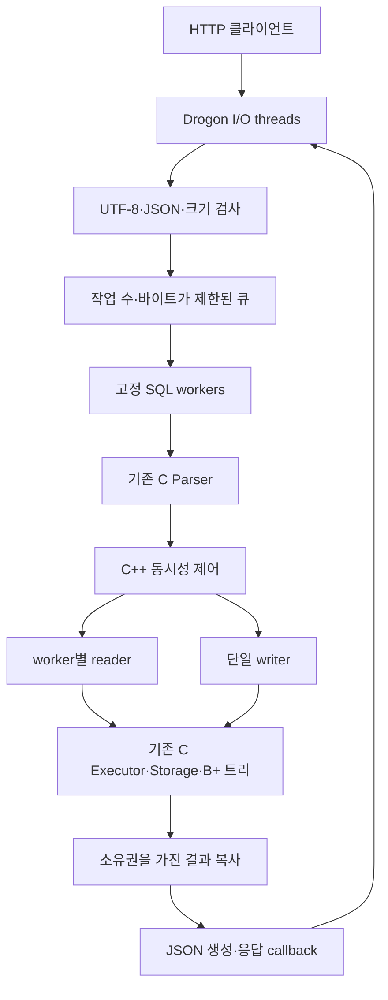

# Phase 3 구현 설명 — C 엔진을 유지한 C++ API 서버

## 1. 구현 범위와 빌드 경계

Phase 3는 기존 `src/common.c`, `parser.c`, `storage.c`, `executor.c`, `bptree.c`를 수정하지 않고 C17 static library인 `minidb_core`로 빌드한다. 기존 CLI의 `src/main.c`는 서버에 링크하지 않는다. C++17 서버는 별도 `server/` 디렉터리에서 빌드한다.

`server/c_api.hpp`가 기존 헤더를 `extern "C"`로 감싼다. 이는 C++ 호출자의 링크 이름을 C 함수 이름과 맞추는 역할이며, C 코드에 동기화를 추가하거나 C++ 코드로 다시 컴파일하는 기능은 아니다.

| 파일 | 책임 |
|---|---|
| `server/main.cpp` | CLI 옵션, DB 디렉터리 잠금, HTTP API, JSON 계약, 종료 순서 |
| `server/engine.hpp`, `engine.cpp` | C ABI adapter, 요청별 파싱, 테이블 컨텍스트, DB 동시성 제어, 결과 소유권 |
| `server/c_api.hpp` | 원본 C 헤더의 링크 경계 |
| `server/thread_pool.hpp`, `thread_pool.cpp` | 고정 worker, FIFO 대기열, 수락 제한, 종료·join, 계측 |
| `server/CMakeLists.txt` | C17/C++17 분리 빌드, CTest, sanitizer 옵션 |
| `server/cmake/DrogonDependency.cmake` | Drogon 커밋 고정 또는 설치된 패키지 연결 |
| `server/tests/` | 엔진·Thread Pool 단위 검증과 실제 HTTP 서버 통합 검증 |

원래 `Makefile`의 CLI·테스트·벤치마크 경로는 유지한다. 실행 명령과 HTTP 계약은 [서버 README](../server/README.md)에 정리했다.

## 2. HTTP와 SQL 실행을 분리한 구조

HTTP handler는 요청을 검사하고 작업을 제출한 뒤 반환한다. 기존 C 엔진의 blocking 파일 접근은 SQL worker가 실행한다. I/O thread에서 future를 기다리거나 파일을 탐색하지 않는다. 완료 callback은 Drogon이 해당 연결의 I/O loop에서 응답을 보내도록 넘긴다.

작업은 SQL 문자열과 응답 callback을 값으로 소유한다. HTTP handler의 지역 변수나 요청 내부 문자열을 참조로 저장하지 않는다. 엔진과 pool 등 서버 수명 객체는 작업이 모두 끝날 때까지 살아 있다.

## 3. 변경하지 않은 C 엔진의 공유 상태 다루기

기존 `Table`에는 파일 스트림, 자동 ID 상태와 B+ 트리 등이 들어 있다. SELECT도 파일 커서를 움직이기 때문에 하나의 `Table*`에 읽기 공유 lock만 붙여 여러 SELECT를 실행하는 구조로 만들지 않았다.

서버 시작 시 writer 테이블 하나와 SQL worker별 reader 테이블 하나를 연다. worker index는 Thread Pool의 수명 동안 고정된다.

| 컨텍스트 | 사용하는 작업 | 파일·인덱스 소유권 |
|---|---|---|
| writer 1개 | INSERT, reader에서 놓친 ID 재조회 | 최신 ID와 전체 최신 인덱스 관리 |
| reader W개 | SELECT | 각자 독립 `FILE*`와 시작 시점 인덱스 보유 |

reader별 mutex는 같은 worker index를 잘못 중복 사용한 호출도 같은 `Table*`에 동시에 들어가지 않게 한다. HTTP 경로에서는 worker가 자기 index를 사용한다.

### 읽기·쓰기 gate

`WriterPreferredGate`는 다음 규칙을 적용한다.

- SELECT는 공유 gate를 획득한다. 서로 다른 reader에서는 동시에 기존 executor를 실행할 수 있다.
- INSERT는 독점 gate를 획득한다. 실행 중인 SELECT가 끝난 뒤 시작하며, 쓰기 중에는 새 SELECT가 실행되지 않는다.
- 기다리는 writer가 있으면 새 reader가 먼저 통과하지 않도록 한다. 이미 진행 중인 reader를 중단하지는 않는다.
- writer 파일을 접근하는 INSERT와 ID fallback은 별도의 writer mutex도 획득한다. gate 뒤에 writer mutex를 획득하는 순서를 유지한다.

이 정책은 읽기와 쓰기를 동시에 진행하는 MVCC가 아니다. writer가 계속 들어올 때 reader의 기아가 없다는 보장이나, 요청 수락 순서와 완료 순서가 같다는 보장도 제공하지 않는다.

### 시작 이후 ID의 일관성

reader 인덱스는 열 때 구축한 상태를 유지한다. 현재 엔진은 append-only이므로 기존 ID의 파일 위치는 바뀌지 않는다. 따라서 reader 인덱스가 찾은 ID는 기존 위치를 그대로 사용한다.

reader 인덱스가 ID를 찾지 못하면 같은 SQL을 writer 컨텍스트에서 다시 실행한다. 이때 공유 gate를 유지하여 INSERT가 끼어들지 못하게 하고, writer mutex로 writer의 파일 커서를 보호한다. 실제 읽기 오류는 정상적인 인덱스 miss로 취급하지 않는다.

이 방식으로 새로 INSERT한 ID를 다음 SELECT에서 찾을 수 있다. reader 인덱스를 실시간으로 복제하거나 새 행마다 전체 인덱스를 재구축하지 않는다.

miss가 났다고 해서 모두 writer로 보내지는 않는다. adapter는 서버 시작 이후 처음 성공한 INSERT의 ID(`first_insert_id`)를 기록한다. writer와 모든 reader는 시작할 때 같은 파일로 인덱스를 만들고, ID는 `last_id + 1`로만 증가한다. 따라서 `first_insert_id`보다 작은 ID는 시작 시점에 이미 있었거나(그러면 모든 reader 인덱스에 있다) 처음부터 없던 ID다. 이런 miss와 INSERT가 아직 없을 때의 miss는 writer를 거치지 않고 빈 결과로 끝낸다. `first_insert_id`는 독점 gate 안에서만 쓰고 공유 gate 안에서 읽으므로 판정 중에 바뀌지 않는다.

fallback은 `first_insert_id` 이상인 ID의 miss에만 남는다. 시작 이후 삽입된 ID와 아직 부여되지 않은 큰 ID가 여기에 해당하며, 이 조회는 writer mutex에서 직렬화된다.

전체 조회·age 조회는 reader의 파일을 새로 탐색한다. 읽는 동안 INSERT가 막히므로 하나의 SELECT 실행 중 파일이 추가되지 않는다. 이 성질은 모든 접근이 이 서버를 통한다는 조건에서 성립한다.

## 4. 요청 하나의 실행 과정

### 실행 전 검사

HTTP 단계에서 UTF-8 JSON 객체인지, `sql` 문자열만 있는지, SQL 바이트 제한을 만족하는지 검사한다. 중복 JSON 키, 추가 JSON 값, 주석·trailing comma 등 허용하지 않은 JSON도 거절한다.

worker에서는 기존 `parser_next`로 첫 문장을 읽고, 다시 호출하여 뒤에 두 번째 문장이나 문법 오류가 없는지 확인한다. 이 확인이 끝나기 전에 INSERT를 실행하지 않는다. 따라서 `INSERT ...; SELECT ...;`와 잘못된 뒤쪽 문법을 포함한 요청은 첫 INSERT도 실행하지 않는다.

파싱된 `Statement`는 RAII 객체가 `statement_free`로 해제한다. SQL 입력에 NUL이 포함되면 C 문자열에서 뒤쪽 내용이 사라지는 문제를 피하도록 미리 거절한다.

### INSERT

서버는 기존 스키마 범위를 미리 확인하여 값 오류를 HTTP 422로 분류한다. 실제 `executor_run`도 원래의 검증을 계속 수행한다.

독점 gate와 writer mutex를 획득한 뒤 기존 executor를 호출한다. 기존 Storage가 파일과 인덱스 작업을 마치고 성공 callback을 호출하면, adapter는 ID와 `committed` 상태만 기록한다. 이 callback은 메모리를 할당하지 않고 C++ 예외를 밖으로 던지지 않는다.

여기서 `committed`/`write_outcome: applied`는 기존 C API가 INSERT 성공을 알렸다는 뜻이다. 트랜잭션 commit, WAL 기록, `fsync`에 의한 전원 장애 내구성을 추가한 뜻은 아니다. 기존 엔진의 flush·오류 처리 계약을 유지한다.

### SELECT

기존 `ResultSink`가 넘기는 `Row`와 이름 문자열은 callback 동안만 유효하다. adapter는 반환 전에 `OwnedRow`로 복사한다. C 객체 내부 포인터를 JSON 처리 단계까지 보관하지 않는다.

수집 callback은 행 수와 보수적인 JSON 크기 예산을 확인한다. 결과 상한이나 할당 실패가 발생하면 C callback의 오류 값으로 전달하고, C++ 예외가 C 호출 경계를 지나가지 않게 한다. 상한 초과 시 부분 결과를 성공으로 내보내지 않는다.

엔진 lock을 해제한 다음 JSON을 생성하고 실제 직렬화 크기를 다시 확인한다. 네트워크 전송 시간 동안 DB gate를 잡고 있지 않는다. 기존 파일에 API가 요구하는 UTF-8로 표현할 수 없는 이름이 있으면 JSON 반환 단계에서 오류로 처리한다.

## 5. 큐, 만료, 종료

Thread Pool은 worker를 처음에 만들고 요청마다 새 thread를 만들지 않는다. mutex와 condition variable로 대기열을 보호하며 작업 실행과 작업 캡처의 해제는 queue mutex 밖에서 한다.

수락 시점에 대기 작업 수와 원본 JSON 본문 바이트 합을 확인한다. 이미 실행 중인 작업은 이 큐 예산에서 제외한다. `try_submit`은 빈자리가 생기기를 기다리지 않고 `Accepted`, `Full`, `Stopped` 중 하나를 반환한다.

작업 수락 실패는 HTTP 503으로 응답한다. worker가 작업을 시작할 때 대기 만료를 검사하며, 만료되면 C 엔진에 진입하지 않는다. 이 검사는 엔진 lock 대기와 실행 중인 파일 I/O를 중단하지 않는다.

정상 종료 순서는 다음과 같다.

1. 신호 handler는 종료 요청 flag만 설정한다.
2. event loop가 종료 요청을 감지하여 신규 작업을 거절한다.
3. main event loop에서 pool의 수락을 막고 기존 작업을 drain한 뒤 worker를 join한다. 별도 HTTP I/O loop들은 이 동안 응답 callback을 처리할 수 있다.
4. event loop를 종료하고 DB 컨텍스트를 해제한다.

수락한 작업은 실행 또는 만료 처리로 끝나지만, 클라이언트가 최종 응답을 수신한다는 보장은 없다. 이미 적용한 INSERT를 연결 종료 때문에 rollback하지 않는다. 무한정 걸리는 엔진 작업을 강제로 중단하거나 종료 시간을 상한으로 묶는 기능도 없다.

## 6. 프로세스와 오류 경계

같은 데이터 디렉터리를 여는 새 Phase 3 서버끼리는 OS 파일 잠금으로 충돌을 막는다. Unix에서는 `flock`, Windows 경로에서는 배타적 파일 열기를 사용한다. 원래 CLI는 이 잠금을 사용하지 않으므로 서버가 실행 중인 디렉터리에 CLI나 다른 프로그램이 접근하지 않아야 한다.

읽기 실패 등 일관성을 계속 신뢰할 수 없는 상태에서는 엔진을 사용 불가능으로 표시하고 이후 요청을 거절한다. INSERT 오류에서는 공개 C API로 writer의 `write_failed` 상태를 확인한다. 이 확인은 일반적인 파일 건강 검사나 실패한 쓰기의 적용 여부 판정이 아니다.

일부 저장 오류와 연결 실패는 INSERT 적용 여부를 확정할 수 없다. 오류 응답의 `unknown`과 성공 callback을 확인한 `applied`를 구별하며, 서버는 실패한 INSERT를 자동 재시도하지 않는다.

## 7. 계측의 의미

`GET /metrics`는 JSON을 반환한다. 시간 누적값의 단위는 마이크로초다.

| 계측 | 해석 |
|---|---|
| `pool.queued`, `queued_bytes` | 현재 대기열의 작업 수·회계 바이트 |
| `pool.active`, `peak_active` | 작업을 가져간 worker 수. 엔진 lock 대기도 포함 |
| `pool.accepted`, `completed`, `rejected` | 수락·처리 종료·수락 거절 작업 수 |
| `pool.failed_tasks` | 작업 callback에서 밖으로 나온 예외를 pool이 포착한 수. `completed`에도 포함 |
| `pool.queue_wait_us`, `max_queue_wait_us` | enqueue에서 worker가 가져갈 때까지의 누적·최대 대기 |
| `pool.expired` | worker의 실행 전 만료 검사에서 끝난 작업 수 |
| `engine.requests` | adapter의 `execute` 호출 수. 만료된 요청은 포함하지 않음 |
| `engine.successful_inserts`, `successful_selects`, `errors` | 엔진 adapter 처리 결과 |
| `engine.fallbacks` | reader ID miss 뒤 writer 인덱스를 조회한 수 |
| `engine.fallbacks_skipped` | reader ID miss 중 서버 시작 이후 성공한 INSERT가 아직 없거나, 조회 ID가 첫 성공 INSERT의 ID(`first_insert_id`)보다 작아서 writer 재조회 없이 빈 결과로 끝난 수 |
| `engine.current_executions`, `peak_executions` | 기존 `executor_run` 호출 범위의 현재·최대 중첩 수 |
| `engine.lock_wait_us` | reader mutex, gate, writer mutex의 누적 대기 |
| `engine.execution_us` | 기존 executor 호출에 쓴 누적 시간. fallback도 별도 호출로 포함 |

engine 카운터는 각각 atomic으로 읽으므로 실행 중인 snapshot에서 모든 수가 정확히 같은 순간의 상태를 나타내지는 않는다. `peak_executions > 1`은 executor 호출이 중첩됐음을 보여주지만, 단일 SQL을 병렬화했거나 처리량이 개선됐다는 증거는 아니다.

## 8. 성능의 범위와 비용

현재 선택은 Phase 1·2를 변경하지 않고 독립 SELECT를 병렬로 실행하기 위한 방법이다. 다음 비용을 감수한다.

- `W`개 worker를 위해 `W + 1`회 테이블을 열고 각각 B+ 트리를 구축한다. 데이터가 크면 초기화 시간과 인덱스 메모리도 그 수에 영향을 받는다.
- 시작 이후의 ID는 reader 인덱스에 없으므로 그 ID와 아직 부여되지 않은 큰 ID의 조회는 writer fallback으로 모일 수 있다. 시작 시점보다 오래된 범위의 없는 ID는 fallback 없이 처리한다.
- 긴 순차 탐색은 writer를 기다리게 한다. writer가 대기하면 이후 reader도 gate에서 기다린다.
- 파일 읽기, 결과 복사, JSON 직렬화와 HTTP 전송 비용은 인덱스 검색 시간과 별개다.
- 결과·대기열 제한은 과도한 단일 요청과 대기열 증가를 제어하지만 프로세스 전체 메모리 사용량을 정확한 상한으로 제한하지 않는다.

따라서 서버 worker 수별 처리량·p50/p95/p99·오류율·queue/lock 대기·메모리·startup 시간은 실제 workload로 측정해야 한다. 기존 Phase 2의 100만 건 ID/age 조회 수치는 C 엔진 성능 근거이며 HTTP 서버의 성능 측정값으로 전용하지 않는다.

실제 완료한 검증과 환경은 아래 10절에 기록한다. 기능 검증과 성능 benchmark는 구별한다.

## 9. 의존성 선택

기본 빌드는 Drogon v1.9.14 커밋 `3aae769cc405cf5abb9d477675c6430924f02c7c`와 해당 커밋이 지정한 Trantor `78e480f5e138acdc05f76c55a2716718cd846364`를 사용한다. CMake에서 ORM·외부 DB client·예제·code generator·외부 라이브러리 테스트를 제외한다. HTTP에 필요하지 않은 TLS도 기본값에서 제외한다.

JSON은 Drogon과 함께 사용하는 JsonCpp로 처리한다. DB는 이 라이브러리의 ORM이나 외부 DB로 교체하지 않는다. JsonCpp·uuid·zlib의 정확한 시스템 패키지 버전과 컴파일러는 실행 환경에 따라 달라지므로 전체 환경을 완전히 고정한 빌드라는 의미는 아니다.

- [Drogon v1.9.14 소스](https://github.com/drogonframework/drogon/tree/v1.9.14)
- [Drogon threading model](https://github.com/drogonframework/drogon/wiki/ENG-FAQ-1-Understanding-drogon-threading-model)
- [Drogon 설치 안내](https://github.com/drogonframework/drogon/wiki/ENG-02-Installation)

Phase 3의 기본 재현 경로는 Linux/WSL와 Docker다. 원래 Phase 1·2의 Windows 빌드를 보존하지만, 그것만으로 새 C++ 서버의 모든 Windows toolchain 조합까지 검증했다는 뜻은 아니다.

## 10. 실제 검증 기록

2026-11-16에 Linux에서 GCC/G++ 14.2.0, CMake 3.31.10, Drogon v1.9.14, JsonCpp 1.9.6으로 확인했다. HTTP 서버는 Release 빌드로 검증했고, sanitizer는 별도 실행 파일을 사용했다.

| 검증 | 결과 |
|---|---|
| 기존 `make test` | C 단위 검증 30,407건, CLI 통합 테스트 28건 통과 |
| Phase 3 Release 빌드 | C17 엔진과 C++17 서버를 분리 컴파일하고 링크 성공 |
| `ctest --test-dir build/server --output-on-failure` | 엔진·Thread Pool·HTTP의 3개 suite 모두 통과. HTTP suite는 8개 테스트 포함 |
| Thread Pool 단독 검증 | 용량·바이트 제한, FIFO, 종료, 동시 producer, 예외 처리 등을 포함한 7개 테스트 통과 |
| ThreadSanitizer | 엔진·Thread Pool 테스트 통과, 데이터 race 보고 없음 |
| AddressSanitizer·UBSan | 엔진 테스트 통과. 이 실행은 `ASAN_OPTIONS=detect_leaks=0` 사용 |
| 100만 행 HTTP 통합 검증 | 병렬 전체 파일 탐색 8건, 동시 INSERT·즉시 ID 조회 64쌍 통과 |
| 기존 코드 보존 | Phase 2 기준 커밋 `20b9d5b55c9e8a78b4fa313a90a1ff343419d1fc`의 `src/`, `Makefile`, 기존 `tests/`와 차이 없음 |

100만 행 검증은 TSV fixture를 미리 생성하고 4개 SQL worker로 수행했다. 100만 번의 HTTP INSERT를 실행한 결과는 아니다. 새 ID는 1,000,001~1,000,064였고 각 INSERT 직후의 조회에서 해당 행을 확인했다. 마지막 계측값은 다음과 같다.

| 계측 | 값 |
|---|---:|
| `pool.accepted`, `pool.completed` | 각각 136 |
| `engine.successful_selects` | 72 |
| `engine.successful_inserts` | 64 |
| `engine.errors` | 0 |
| `pool.rejected`, `pool.expired`, `pool.failed_tasks` | 각각 0 |
| `engine.peak_executions` | 4 |
| `engine.fallbacks` | 64 |

이 결과는 큰 파일에서의 기능·일관성과 독립 executor 호출의 중첩을 확인한다. worker 수별 처리량이나 지연 시간 비교를 수행한 성능 benchmark는 아니다. 같은 검증을 재현하는 명령은 [서버 README](../server/README.md#검증-명령)에 있다.

HTTP 통합 테스트에는 잘못된 입력의 INSERT 부작용 방지, 결과·큐 상한, 큐 대기 만료, 두 서버의 동일 디렉터리 접근 차단, 정상 종료 중 수락한 INSERT 처리, 재시작, 64비트 ID와 잘못된 저장 UTF-8 처리가 포함된다. 저장 쓰기 오류 후의 사용 불가 상태는 엔진 테스트에서 실제 파일 크기 제한으로 검증했다.

LeakSanitizer는 실행 환경의 ptrace 제약 때문에 실행할 수 없어 메모리 누수 검증 결과에는 포함하지 않는다. HTTP 프레임워크 전체에 sanitizer를 적용한 검증, Docker 이미지 실행, Windows 네이티브 서버 빌드는 이번 검증 범위에 포함하지 않았다.
